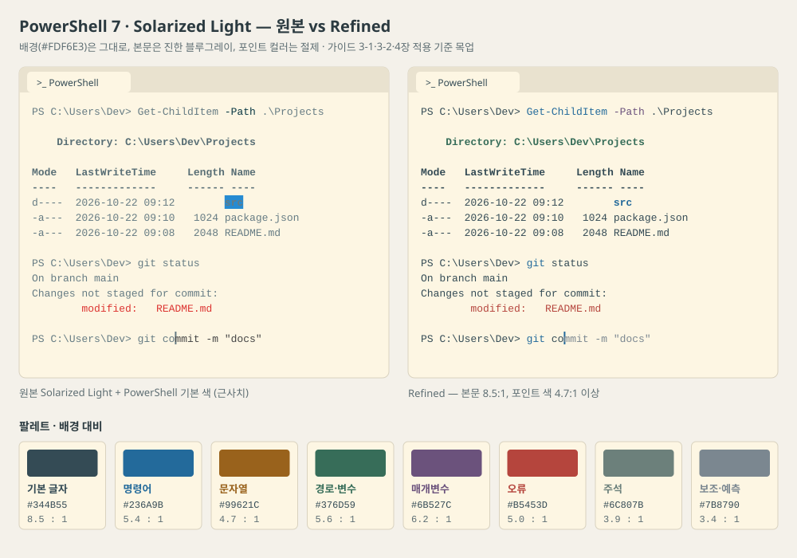

# PowerShell 7 · Solarized Light 다듬기 가이드

> **환경** Windows Terminal + PowerShell 7.4 이상 (PSReadLine 2.3 이상)
> **목표** Solarized Light의 아이보리 배경은 그대로 두고, 글자 대비·구문 강조·폰트만 손봐서 선명하게
> **작성 기준일** 2026-10-22

---

## 목차

0. [검토 메모 — 원안에서 바뀐 점](#0-검토-메모--원안에서-바뀐-점)
1. [왜 흐릿해 보이나](#1-왜-흐릿해-보이나)
2. [추천 색상 조합](#2-추천-색상-조합)
3. [Windows Terminal 외형 설정](#3-windows-terminal-외형-설정)
4. [PowerShell 색상 설정 (프로필)](#4-powershell-색상-설정-프로필)
5. [적용 확인](#5-적용-확인)
6. [미감 팁](#6-미감-팁)
7. [문제 해결](#7-문제-해결)
8. [출처](#8-출처)

---

## 0. 검토 메모 — 원안에서 바뀐 점

원안의 방향(배경 유지 + 글자 대비 강화 + PSReadLine·`$PSStyle` 색 지정)은 맞습니다. 아래 사항을 확인하거나 고쳤습니다.

| # | 항목 | 결과 |
|---|---|---|
| 1 | "Solarized는 대비가 부족하다" | **확인.** 원본 포인트 색(노랑·청록·녹색)은 배경 대비 약 **3:1**로, 글자 권장 기준(WCAG 4.5:1)에 못 미침 |
| 2 | 추천 색상 대비 | 계산해서 표에 넣음. 본문용 색은 모두 4.5:1 이상. 보조 글자(3.4:1)와 주석(3.9:1)은 일부러 흐리게 둔 색 |
| 3 | PSReadLine `'#RRGGBB'` 표기 | **동작 확인** (PSReadLine 소스). 단 이 표기는 **글자색**으로만 해석됨 → 배경색이 필요한 `Selection`, `ListPredictionSelected`는 `$PSStyle.Background.FromRgb()` 사용 |
| 4 | PSReadLine 누락 항목 | 기본값이 밝은 배경에서 안 보이는 `ListPrediction`(노랑), `ListPredictionSelected`(짙은 회색 배경), `ContinuationPrompt`(연회색) 추가 |
| 5 | `$PSStyle` 누락 항목 | 기본이 밝은 노랑·청록인 `Verbose`, `Debug`, `ErrorAccent`, `Progress.Style` 추가 |
| 6 | `$PROFILE` 위치 | `$PROFILE`은 **현재 호스트 전용**이라 VS Code 내장 터미널에는 적용 안 됨 → 둘 다 쓰면 `$PROFILE.CurrentUserAllHosts` 사용 |
| 7 | "git 색은 안 바뀐다" | 맞음. Windows Terminal `foreground`는 기본 글자색만 바꿈 → git 등 외부 프로그램 색까지 다듬는 **선택 사항: 전용 색 구성표**(3-2) 추가 |
| 8 | 터미널 미리보기 | 원문의 HTML 미리보기를 **원본 vs Refined 비교 목업**(SVG)으로 다시 만들어 2장에 넣음 |

---

## 1. 왜 흐릿해 보이나

- **낮은 대비** — Solarized는 일부러 채도와 대비를 낮춘 팔레트입니다. 원본 본문색 `#657B83`은 배경 대비 4.1:1, 노랑 `#B58900`·청록 `#2AA198`·녹색 `#859900`은 약 3:1입니다.
- **어두운 배경용 기본 색** — PowerShell과 PSReadLine의 기본 색은 어두운 배경 기준입니다. 대부분 배경색을 지정하지 않기 때문에, 밝은 배경에서는 밝은 글자가 묻힙니다. Microsoft 문서도 밝은 테마에서는 색을 따로 지정하라고 안내합니다.
- **배경과 같은 "밝은 흰색"** — Solarized Light는 ANSI 밝은 흰색(`brightWhite`)이 배경색 `#FDF6E3`과 같아서, 그 색을 쓰는 글자는 아예 보이지 않습니다. 3장의 `adjustIndistinguishableColors`가 이를 보정합니다.

---

## 2. 추천 색상 조합

**Solarized Light — Refined**: 배경은 유지하고, 본문은 진한 블루그레이, 포인트 컬러는 절제합니다.



> 목업 파일: `mockups/powershell-solarized-light-preview.svg` (브라우저나 VS Code에서 바로 열림). 왼쪽은 원본 + PowerShell 기본 색을 근사한 것으로, 폴더 이름 `src`가 파란 배경에 묻히고 자동 완성 예측 글자(`mmit -m "docs"`)가 진하게 표시돼 직접 입력한 글자와 구분되지 않는 문제가 보입니다.

| 요소 | 색 | 배경 대비 | 의도 |
|---|---|---|---|
| 배경 | `#FDF6E3` | — | 원본 Solarized Light 유지 |
| 기본 글자 | `#344B55` | **8.5 : 1** | 가독성 강화 |
| 명령어 · 형식 | `#236A9B` | 5.4 : 1 | 선명하지만 차분한 파랑 |
| 문자열 · 숫자 | `#99621C` | 4.7 : 1 | 따뜻한 갈색 |
| 경로 · 변수 | `#376D59` | 5.6 : 1 | 짙은 녹색 |
| 매개변수 · 키워드 | `#6B527C` | 6.2 : 1 | 절제된 보라 |
| 연산자 | `#526873` | 5.4 : 1 | 본문보다 한 단계 흐리게 |
| 오류 | `#B5453D` | 5.0 : 1 | 부드럽지만 확실한 빨강 |
| 주석 | `#6C807B` | 3.9 : 1 | 일부러 흐리게 (더 선명하게: `#5E6E73`, 4.9 : 1) |
| 보조 글자 · 예측 | `#7B8790` | 3.4 : 1 | 시각적 위계용 — 본문에는 쓰지 말 것 |
| 선택 영역 배경 | `#D8E7E3` | — | 그 위의 기본 글자 대비 7.2 : 1 |

> 대비는 WCAG 2.1 공식으로 계산했습니다. 일반 글자 권장 기준은 4.5 : 1입니다.

---

## 3. Windows Terminal 외형 설정

`Ctrl`+`,` → 왼쪽 아래 **JSON 파일 열기**를 누릅니다.

### 3-1. 기본안 — 프로필에 덮어쓰기

`profiles.list` 안의 **PowerShell 7 프로필**에 아래 항목을 **추가·병합**합니다. 기존 프로필(특히 `guid`, `commandline`, `source`)을 통째로 바꾸지 마세요.

```json
{
  "colorScheme": "Solarized Light",
  "foreground": "#344B55",
  "cursorColor": "#236A9B",
  "selectionBackground": "#D8E7E3",
  "adjustIndistinguishableColors": "indexed",
  "intenseTextStyle": "bold",
  "opacity": 100,
  "useAcrylic": false,
  "padding": "12, 10",
  "font": {
    "face": "Cascadia Mono",
    "size": 13,
    "weight": "medium"
  }
}
```

| 설정 | 하는 일 |
|---|---|
| `foreground` | 기본 글자색을 진하게 |
| `adjustIndistinguishableColors: "indexed"` | ANSI 색 중 배경과 구분이 안 되는 색(위의 밝은 흰색 등)을 자동 보정 |
| `intenseTextStyle: "bold"` | "강조" 글자를 밝은 색 대신 **굵게** 표시 — 밝은 배경에서 밝은 색 강조는 오히려 흐려짐 |
| `opacity: 100`, `useAcrylic: false` | 밝은 테마에서 배경이 비치면 명암이 들쭉날쭉해 지저분해 보임 |

### 3-2. 선택 — git 출력까지 다듬는 전용 색 구성표

3-1은 **기본 글자색만** 바꿉니다. `git status`의 빨강·녹색, `ls`류 출력 등 외부 프로그램이 쓰는 ANSI 색은 원본 Solarized(약 3:1) 그대로입니다. 이것까지 선명하게 하려면 색 구성표를 하나 만듭니다.

① `settings.json`의 `schemes` 배열에 추가:

```json
{
  "name": "Solarized Light Refined",
  "background": "#FDF6E3",
  "foreground": "#344B55",
  "cursorColor": "#236A9B",
  "selectionBackground": "#D8E7E3",
  "black": "#073642",
  "red": "#B5453D",
  "green": "#5B7300",
  "yellow": "#8A6800",
  "blue": "#236A9B",
  "purple": "#A8366F",
  "cyan": "#16756E",
  "white": "#EEE8D5",
  "brightBlack": "#5E6E73",
  "brightRed": "#B4501A",
  "brightGreen": "#376D59",
  "brightYellow": "#99621C",
  "brightBlue": "#2F5F8A",
  "brightPurple": "#6B527C",
  "brightCyan": "#2F6F6F",
  "brightWhite": "#FDF6E3"
}
```

② 3-1의 프로필에서 `"colorScheme": "Solarized Light Refined"`로 바꾸고, `foreground`·`cursorColor`·`selectionBackground` 세 줄은 지웁니다 (구성표에 들어 있음).

- 흰색 두 개(`white`, `brightWhite`)를 뺀 14색은 모두 배경 대비 **4.7 : 1 이상**입니다.
- 흰색 계열은 "배경색 위에 쓰는 밝은 글자"라는 의미를 지키려고 원본을 유지했고, 글자로 쓰일 때는 `adjustIndistinguishableColors`가 보정합니다.

---

## 4. PowerShell 색상 설정 (프로필)

체감 효과가 가장 큰 단계입니다.

### 4-1. 프로필 파일 열기

```powershell
New-Item -ItemType Directory -Force -Path (Split-Path $PROFILE) | Out-Null
if (!(Test-Path $PROFILE)) {
    New-Item -ItemType File -Path $PROFILE | Out-Null
}
notepad $PROFILE
```

> **VS Code 내장 터미널에서도 쓴다면** 위의 `$PROFILE`을 모두 `$PROFILE.CurrentUserAllHosts`로 바꾸세요. 그냥 `$PROFILE`은 "현재 호스트" 전용이라 Windows Terminal과 VS Code가 서로 다른 파일을 읽습니다.

### 4-2. 프로필 맨 아래에 추가

```powershell
# ── Solarized Light - Refined ─────────────────────────────
# PSReadLine: 입력 중인 명령어 색
Set-PSReadLineOption -Colors @{
    Default                = '#344B55'
    Command                = '#236A9B'
    Parameter              = '#6B527C'
    String                 = '#99621C'
    Variable               = '#376D59'
    Keyword                = '#6B527C'
    Number                 = '#99621C'
    Operator               = '#526873'
    Member                 = '#344B55'
    Type                   = '#236A9B'
    Comment                = '#6C807B'
    Error                  = '#B5453D'
    Emphasis               = '#236A9B'
    ContinuationPrompt     = '#7B8790'
    InlinePrediction       = '#7B8790'
    ListPrediction         = '#376D59'
    # 아래 둘은 배경색 → '#RRGGBB' 대신 Background.FromRgb 사용
    ListPredictionSelected = $PSStyle.Background.FromRgb(0xD8E7E3)
    Selection              = $PSStyle.Background.FromRgb(0xD8E7E3) + $PSStyle.Foreground.FromRgb(0x344B55)
}

# $PSStyle: PowerShell 자체 출력 색
$PSStyle.Formatting.TableHeader  = $PSStyle.Foreground.FromRgb(0x344B55) + $PSStyle.Bold
$PSStyle.Formatting.FormatAccent = $PSStyle.Foreground.FromRgb(0x376D59)
$PSStyle.Formatting.ErrorAccent  = $PSStyle.Foreground.FromRgb(0x236A9B)
$PSStyle.Formatting.Error        = $PSStyle.Foreground.FromRgb(0xB5453D)
$PSStyle.Formatting.Warning      = $PSStyle.Foreground.FromRgb(0x99621C)
$PSStyle.Formatting.Verbose      = $PSStyle.Foreground.FromRgb(0x6C807B)
$PSStyle.Formatting.Debug        = $PSStyle.Foreground.FromRgb(0x6B527C)
$PSStyle.Progress.Style          = $PSStyle.Foreground.FromRgb(0x236A9B)

# 폴더 및 파일 색 (Get-ChildItem)
$PSStyle.FileInfo.Directory    = $PSStyle.Foreground.FromRgb(0x236A9B) + $PSStyle.Bold
$PSStyle.FileInfo.SymbolicLink = $PSStyle.Foreground.FromRgb(0x376D59)
$PSStyle.FileInfo.Executable   = $PSStyle.Foreground.FromRgb(0x6B527C)
```

저장 후 `. $PROFILE`을 실행하면 현재 창에도 바로 적용됩니다.

**원안 대비 추가한 것**

| 항목 | 기본값 | 밝은 배경에서 문제 |
|---|---|---|
| `ListPrediction` | 노랑 | 목록형 예측(`F2`로 전환) 글자가 거의 안 보임 |
| `ListPredictionSelected` | 짙은 회색 배경 | 선택 줄만 시커멓게 튐 |
| `ContinuationPrompt` | 연회색 | 여러 줄 입력 시 `>>`가 안 보임 |
| `Selection` | 검정 글자 + 흰 배경 | 동작은 하지만 선택 영역색(`#D8E7E3`)과 통일 |
| `Verbose`, `Debug` | 밝은 노랑 | `-Verbose` 출력이 거의 안 보임 |
| `ErrorAccent` | 밝은 청록 | 오류 메시지 강조 부분이 흐림 |
| `Progress.Style` | 노랑 | 진행 표시줄이 흐림 |

> 이 설정은 **명령어 입력**과 **PowerShell 자체 출력**에만 적용됩니다. `git` 등 외부 프로그램이 직접 지정하는 색은 3-2의 색 구성표로 다듬습니다.

---

## 5. 적용 확인

```powershell
$PSVersionTable.PSVersion          # 7.4 이상
(Get-Module PSReadLine).Version    # 2.3 이상
Get-PSReadLineOption | Select-Object *Color   # 바뀐 색 확인
Write-Warning '경고 색 확인'
Write-Verbose '자세한 출력 색 확인' -Verbose
Get-ChildItem                      # 폴더·파일 색
git status                         # 외부 프로그램 색 (3-2 적용 시 개선)
```

---

## 6. 미감 팁

- **폰트:** `Cascadia Mono` 13pt부터 시작하세요. Cascadia Mono에는 한글 글꼴이 없어 한글은 시스템 글꼴(맑은 고딕)로 대신 표시됩니다. 한글 비중이 높다면 **D2Coding**과 비교해 보세요.
- **프롬프트:** 여러 색을 쓰기보다 **현재 경로 + Git 브랜치** 정도만 표시하는 구성이 Solarized Light에 잘 어울립니다.
- **색 종류를 늘리지 않기:** 파랑·녹색·보라를 주로 쓰고, 주황과 빨강은 의미(경고·오류)가 있을 때만 쓰면 훨씬 정돈돼 보입니다.

---

## 7. 문제 해결

| 증상 | 원인 / 해결 |
|---|---|
| 프로필 실행 시 `Set-PSReadLineOption` 오류 (알 수 없는 색 키) | PSReadLine이 오래됨 (`ListPrediction` 계열은 2.2 이상) → `Install-Module PSReadLine -Force` 또는 PowerShell 업데이트 |
| `$PSStyle`이 없다는 오류 | Windows PowerShell 5.1에서 실행 중 → PowerShell 7(`pwsh`) 프로필에 넣기 |
| VS Code 터미널에는 적용 안 됨 | 4-1의 `$PROFILE.CurrentUserAllHosts` 사용 |
| 일부 글자가 아예 안 보임 | 배경색과 같은 밝은 흰색 → `adjustIndistinguishableColors: "indexed"` 확인 |
| `git` 출력 색이 여전히 흐림 | 3-1만 적용한 상태 → 3-2 색 구성표 적용 |
| 프로필 스크립트가 실행되지 않음 | 실행 정책 → `Get-ExecutionPolicy` 확인, 필요 시 `Set-ExecutionPolicy -Scope CurrentUser RemoteSigned` |

---

## 8. 출처

- [Microsoft — Configuring a light colored theme (PowerShell 문서)](https://learn.microsoft.com/powershell/scripting/learn/shell/using-light-theme)
- [Microsoft — Set-PSReadLineOption](https://learn.microsoft.com/powershell/module/psreadline/set-psreadlineoption)
- [Microsoft — about_ANSI_Terminals (`$PSStyle`)](https://learn.microsoft.com/powershell/module/microsoft.powershell.core/about/about_ansi_terminals)
- [Microsoft — Windows Terminal 프로필 외형 설정](https://learn.microsoft.com/windows/terminal/customize-settings/profile-appearance)
- [Microsoft — Windows Terminal 색 구성표](https://learn.microsoft.com/windows/terminal/customize-settings/color-schemes)
- [PowerShell/PSReadLine 소스 — 색 값 해석(`#RRGGBB`, 배경색 처리)](https://github.com/PowerShell/PSReadLine)
- [W3C — WCAG 2.1 대비 기준(1.4.3)](https://www.w3.org/TR/WCAG21/#contrast-minimum)
- [Solarized 원본 팔레트](https://ethanschoonover.com/solarized/)
