# WorkTool 디자인 시안

WPF로 옮길 때 기준으로 삼는 화면 시안과 구현된 화면을 모았습니다. 「실제 화면」은 앱으로 그린 그림이고, 「목업」은 디자인 검토용 그림입니다. 구현 여부는 각 절에서 안내합니다.
색·크기 값은 WPF 테마 파일 한 곳에 모으고, 화면 모듈은 이 값만 씁니다.

## 화면

### 홈
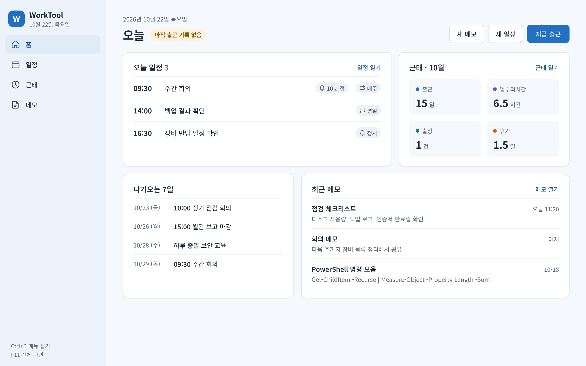

### 일정
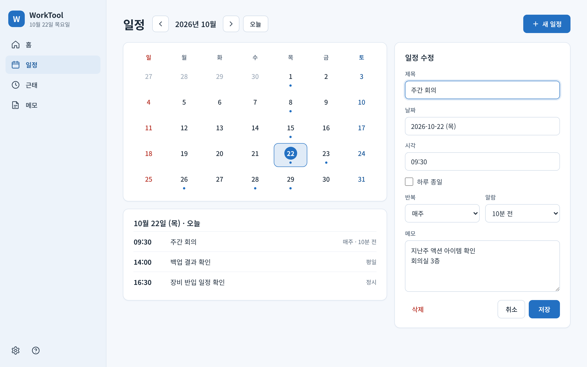

### 근태
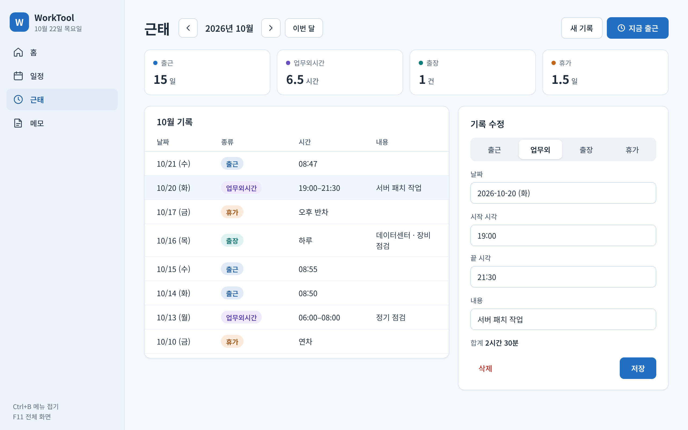

### 메모
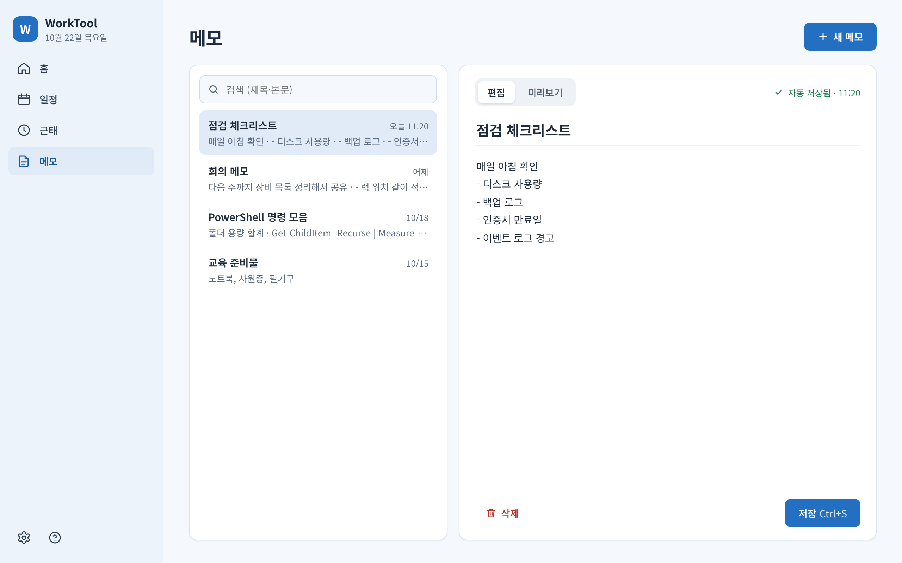

### 알람 알림 창
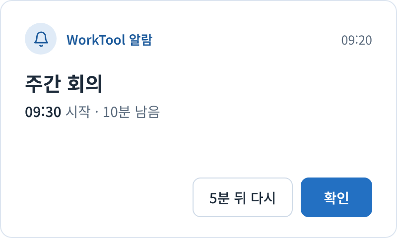

### 다크 모드 (테마만 바꾼 예)
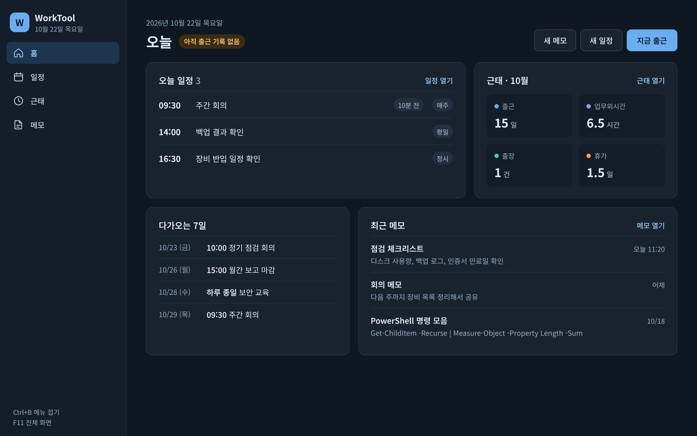

### 디자인 기준
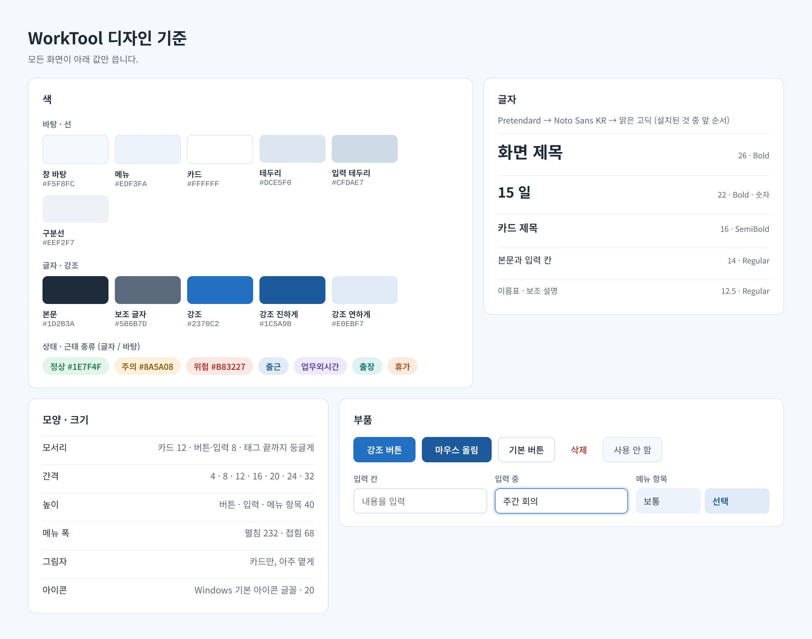

### 문서 (실제 화면)
폴더 트리 + 파일 목록. 파일은 원래 프로그램으로 엽니다. 폴더 이름은 예시입니다.

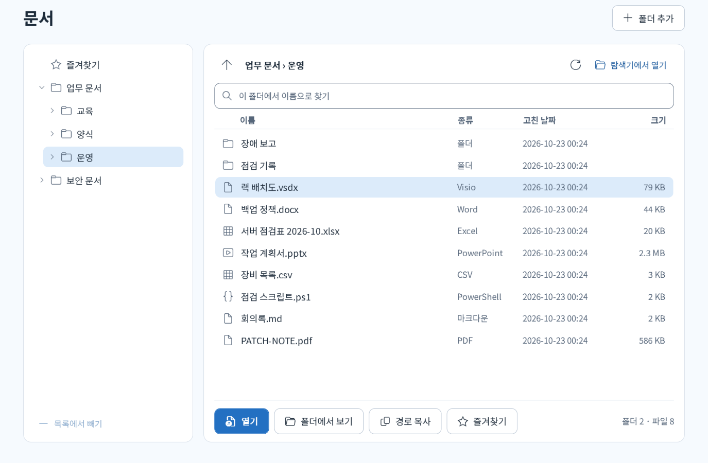

### 마크다운 보기 (실제 화면)
메모 본문 · `.md` 문서를 보여 주는 공통 부품입니다. 시안이 아니라 WPF 버전 코드로 그린 그림입니다.

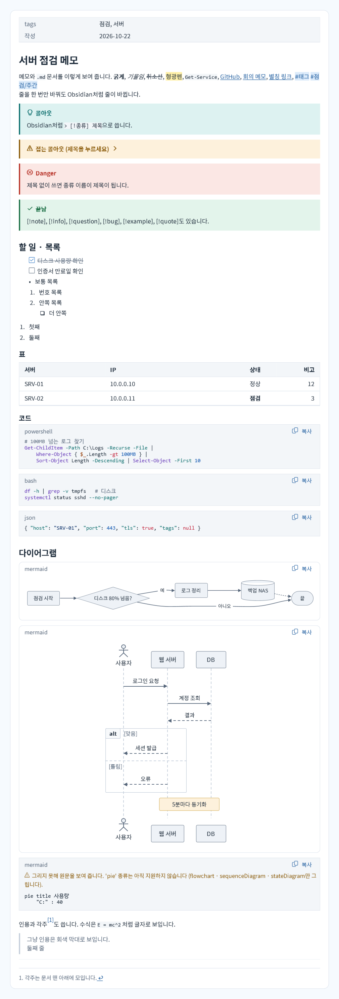

### 활성 작업 (목업)

**아래 그림은 가짜 데이터로 만든 디자인 목업입니다.** 실제 기능은 WPF의 「활성 작업」 탭에 구현했습니다. 사용법과 지원 범위는 [WPF README의 활성 작업](../wpf/README.md#활성-작업)에 있습니다. 실제 표는 Windows 기본 WPF DataGrid를 사용하므로 그룹 화살표·열 머리글의 모양은 목업과 조금 다릅니다.

폰에서는 [확대본 PNG](active-tasks-detail.png)를 먼저 보세요. 전체 화면은 1280 × 672 기준이며, 확대본은 같은 화면의 일부와 닫기 확인창을 크게 나눠 보여 줍니다. 모바일 앱 화면은 아닙니다.

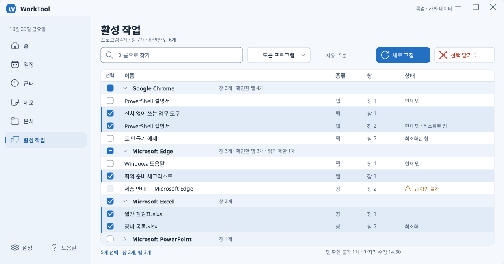

전체 화면: `apps/WorkTool/design/active-tasks.svg` · [PNG](active-tasks.png)

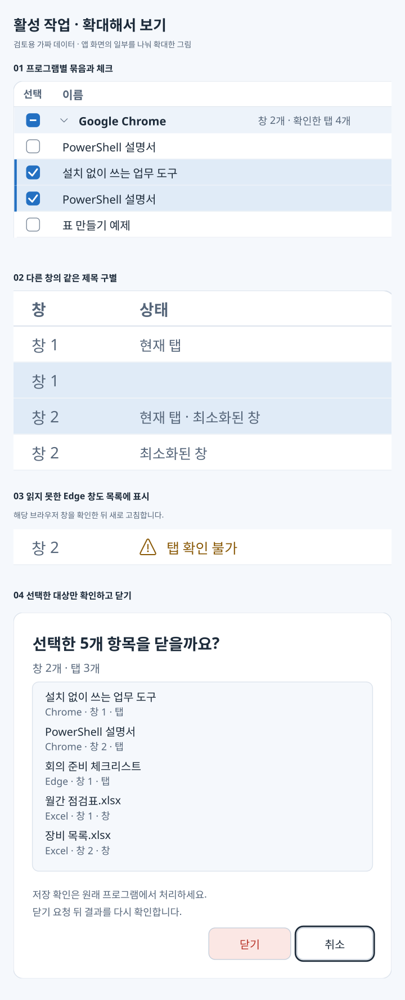

확대본: `apps/WorkTool/design/active-tasks-detail.svg` · [PNG](active-tasks-detail.png)

**자동 새로 고침 설정**: 새로 고침 버튼 우클릭 → [자동…] → 분 단위 간격 → [적용]. [수동]을 고르면 자동 갱신을 멈춥니다. 버튼을 왼쪽 클릭하면 모드와 관계없이 한 번 갱신합니다.

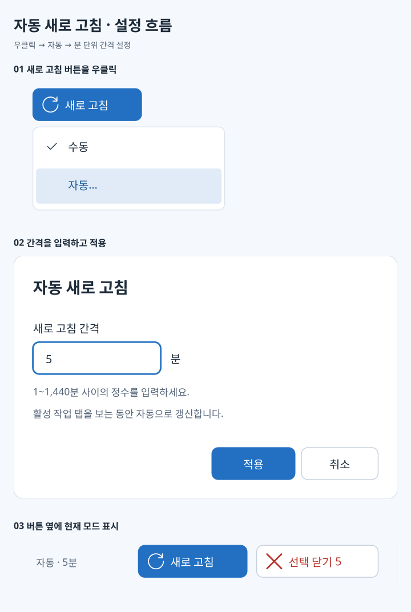

설정 확대본: `apps/WorkTool/design/active-tasks-refresh.svg` · [폰에서 PNG 보기](active-tasks-refresh.png)

**화면에서 확인할 것**
- 프로그램별 묶음을 접고 펼칩니다. 표는 선택 · 이름 · 종류 · 창 · 상태 순서입니다.
- Chrome의 「PowerShell 설명서」는 창 1과 창 2에 각각 있습니다. 제목이 같아도 별도 탭으로 유지합니다.
- 같은 창 안에서 제목까지 겹치면 이름 뒤에 탭 순서를 표시합니다. 닫기 직전에는 창·탭 식별자와 제목을 다시 확인합니다.
- 체크한 대상은 창 2개와 탭 3개입니다. 접은 PowerPoint 묶음은 선택하지 않았습니다. 그룹 체크는 현재 검색·필터에 해당하는 항목만 선택합니다.
- Edge 창 2는 「탭 확인 불가」입니다. 확인한 탭 수에 포함하지 않고, 탭 대신 창 전체를 닫지도 않습니다. 해당 브라우저 창을 확인한 뒤 [새로 고침]으로 다시 수집합니다.
- 검색·필터 변경 시 체크를 초기화합니다. 새로 고침 때에는 식별이 같은 항목의 체크와 스크롤 위치를 유지합니다.
- [선택 닫기]는 대상 목록을 확인한 뒤 일반 닫기를 요청합니다. 저장 확인은 원래 프로그램에서 처리하고, 강제 종료하지 않습니다. 결과는 닫힘 · 이미 없음 · 확인 필요 · 실패 · 취소로 구분합니다.

**업무 PC 조건**
- PowerShell 7 기본 명령과 Windows 기본 .NET UI Automation API만 사용합니다. 추가 앱·확장 프로그램·외부 모듈은 설치하지 않습니다.
- 앱 창과 브라우저의 탭 제목만 대상으로 합니다. 고정 아이콘·백그라운드 프로세스·브라우저 프로필·방문 기록·페이지 본문은 대상이 아닙니다.
- 탭 진입, 수동 새로 고침, 닫기 처리 후에 수집합니다. 자동 모드에서는 활성 작업 탭이 보이는 동안 지정 간격으로 추가 수집합니다. 설정·닫기 대화상자가 열려 있거나 다른 작업이 처리 중이면 기다립니다. 수집을 위해 브라우저 창을 복원하거나 탭을 전환하지 않습니다.
- 실제 수집 가능 범위는 Chrome·Edge와 업무 PC 환경에서 검증해야 합니다. 이 목업은 모든 탭을 읽을 수 있다는 검증 결과가 아닙니다. 수집한 실제 제목은 파일에 저장하지 않습니다.

**목업 파일**
- 샘플 데이터: [active-tasks-sample.json](active-tasks-sample.json). `isMock: true`인 가짜 데이터만 담습니다. 실사용 데이터 형식이 아닙니다.
- 다시 만들기: `pwsh -NoProfile -STA -File apps/WorkTool/design/build-active-tasks-mockups.ps1`
- [build-active-tasks-mockups.ps1](build-active-tasks-mockups.ps1)은 샘플에서 SVG와 PNG 세 쌍을 만듭니다. PowerShell과 기본 .NET으로 그림만 렌더링하며, 실제 화면을 캡처하거나 실행 중인 창을 조회하지 않습니다. 업무 PC로 복사할 파일이 아닙니다.

**목업 검수 범위**
- 전체 화면과 확대본의 배치, 선택 수·대상 일치, 목업 데이터와 이미지 일치, 외부 리소스 없는 SVG를 확인합니다.
- 실제 모달의 취소·오류·적용, 그룹 체크, 검색 후 체크 해제, 접기 유지, 타이머 경로는 전용 테스트 창에서 검사합니다. Chrome·Edge는 새 테스트 프로필의 가짜 페이지로 조회·개별 닫기를 검사합니다. 업무 PC의 DRM 앱·보안 정책과 모든 화면 배율 조합은 별도 현장 확인이 필요합니다.

### 사용자 구성 업무 (목업 · 미구현)

업무를 구성하는 사람과 실제 사용하는 사람의 흐름을 함께 확인하는 시안입니다. 모든 이름·입력·결과는 가짜이며, 알람 예약·파일 생성·ping도 시뮬레이션입니다.

**직접 눌러 보기:** [workflows-playground.html](workflows-playground.html). 파일 하나를 내려받아 브라우저에서 엽니다. 구성 → 사용 → 결과를 오가며 폼·단계·변수 연결을 바꿀 수 있습니다. 외부 리소스·설치·서버가 필요 없습니다. 변경과 이력은 현재 탭의 메모리에만 있고 새로고침하면 초기화됩니다.

체험 HTML은 WPF 구현이 아닙니다. 기존 샘플 세 가지에 업무 시작 예시를 더한 독립 체험 데이터가 HTML 안에 있습니다. 아래 정적 그림과 JSON의 생성 방식은 그대로 유지합니다.

HTML 배치 기준: 기존 색·본문 14·제목 26·카드 제목 16·보조 12.5, 입력 최소 높이 40을 사용합니다. 업무 목록 폭 232, 설명 폭 280, 본문 최소 폭 360, 최대 전체 폭 1600입니다. 1008 미만은 설명을 본문 아래로, 640 미만은 업무 목록을 위로 배치합니다. 브라우저 기본 포커스·대화상자 동작을 살리고 줄바꿈으로 작은 화면을 지원합니다. 이 값은 체험 열람용이며 WPF UI 토큰을 바꾸지 않습니다.

직접 조작한 화면: `apps/WorkTool/design/workflows-playground-use.jpg` · [휴대폰 폭 입력·미리보기](workflows-playground-use.jpg), `apps/WorkTool/design/workflows-playground-result.jpg` · [사용 결과 화면 일부](workflows-playground-result.jpg). 가짜 입력만 있는 로컬 HTML 화면입니다.

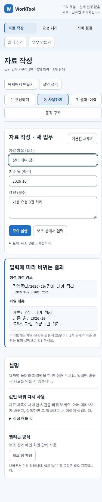

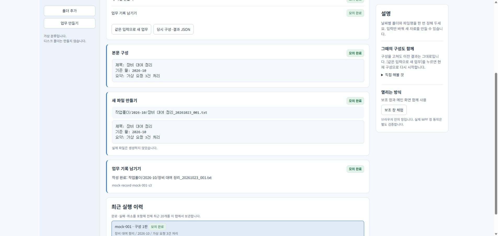

검수: 모의 실행기의 20개 검사를 통과했습니다. 브라우저에서 폼 항목·선택지 추가, 폴더 변수 연결, 실행 결과, 알람 표시·다시 알림·연결 업무, 가상 URL 탭, 모달·함께 쓰는 창, 500개 모의 대상 취소를 확인했습니다. 잘못된 참조·순서, 저장 실패, 대소문자 파일 충돌, 과도한 문자열 증가와 오래된 보조 폼을 방어합니다. 휴대폰 폭 390에서 문서 가로 넘침과 중복 ID가 없었습니다. 실제 WPF 성능·복구·알람 서비스 검증은 아닙니다.

- [사용법과 결과 비교](../../../docs/plans/workflows-preview.md) — 세 가지 업무, 설정 변경 전후, 내부 API 제안, 현재 구현과의 차이
- 전체 화면: `apps/WorkTool/design/workflows-overview.svg` · [SVG](workflows-overview.svg) · [PNG](workflows-overview.png)
- 구성 편집: `apps/WorkTool/design/workflows-builder.svg` · [SVG](workflows-builder.svg) · [PNG](workflows-builder.png)
- 사용 결과: `apps/WorkTool/design/workflows-result.svg` · [SVG](workflows-result.svg) · [PNG](workflows-result.png)
- 폰용 확대본: [요청 처리](workflows-request.png) · [자료 작성](workflows-report.png) · [서버 점검](workflows-check.png)
- 원본: [샘플 JSON](workflows-sample.json) · [계산한 모의 결과](workflows-results.json) · [목업 생성 스크립트](build-workflows-mockups.ps1)

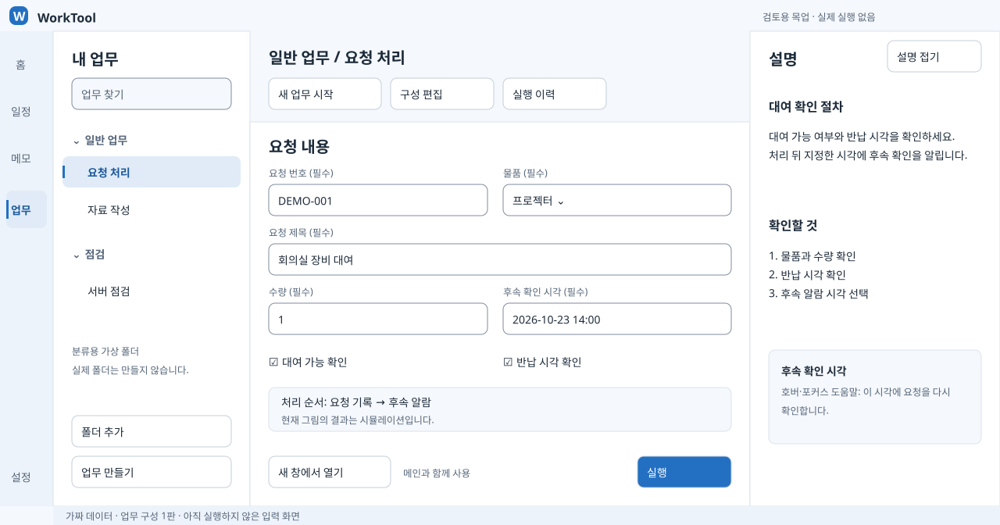

아래 값은 이 목업의 배치 기준입니다. 구현된 앱 토큰이나 확정된 사용자 데이터 형식은 아닙니다.

- 전체 화면: 1280 × 672. 제목 줄 40, 접힌 앱 메뉴 68, 업무 트리 252, 오른쪽 설명 320, 아래 상태 줄 24. 중앙은 남은 폭을 씁니다.
- 입력·명령 높이 40, 패널 안쪽 여백 24, 항목 간격 12, 카드 반지름 12, 입력·버튼 반지름 8. 기존 색·글꼴·본문 14·보조 12.5·소제목 20을 사용합니다.
- 폰용 그림은 논리 폭 480의 설명용 세로 판을 1.5배 확대해 SVG 폭 720으로 내보냅니다. PNG는 여기에 1.5배의 렌더링 밀도를 적용해 폭 1080입니다. 모바일 앱 시안이 아닙니다. 단계 높이는 글 길이에 따라 늘립니다.
- PNG는 SVG와 동일한 도형 목록을 WPF로 렌더링합니다. 실제 화면 캡처나 외부 리소스를 사용하지 않습니다.
- 생성기는 글자를 측정해 줄바꿈과 그림 경계를 검사합니다. 실제 키보드·호버·모달·화면 배율·대비 테마 동작은 아직 검증하지 않았습니다.

## 기준 값

**바탕 · 선**
- 창 바탕 `#F5F8FC` · 메뉴 `#EDF3FA` · 카드 `#FFFFFF`
- 테두리 `#DCE3EC` · 입력 테두리 `#7F8C9C`(흰 바탕과 3:1) · 버튼 테두리 `#C4CEDA` · 구분선 `#EEF2F7`

**글자 · 강조**
- 본문 `#1D2B3A` · 보조 글자 `#56667A` · 메뉴 글자 `#2E3E50` (보조 글자는 모든 테마의 메뉴 바탕에서 4.5:1 이상)
- 강조 `#2370C2` · 강조 진하게(마우스 올림, 선택 글자) `#1C5A9B` · 강조 연하게(선택 바탕) `#E0EBF7`

**상태 (글자 / 바탕)**
- 정상 `#1E7F4F` / `#E3F4EB` · 주의 `#8A5A08` / `#FDF1DC` · 위험 `#B83227` / `#FBE7E4`

**근태 종류 (글자 / 바탕)**
- 출근 `#1C5A9B` / `#E0EBF7` · 업무외시간 `#5A42AE` / `#EEEAFB`
- 출장 `#0B6E6D` / `#DDF2F1` · 휴가 `#9C4E0F` / `#FCEBDC`

**글자 크기** (글꼴: Pretendard → Noto Sans KR → 맑은 고딕, 설치된 것 중 앞 순서)
- 화면 제목 26 Bold · 숫자 강조 22 Bold · 카드 제목 16 SemiBold
- 본문·입력 14 Regular · 이름표·보조 12.5 Regular
- 글자는 부드럽게 그린다 (WPF `TextFormattingMode="Ideal"`). 창 투명도 때문에 ClearType은 쓸 수 없고, 이때 `Display`로 그리면 획이 픽셀에 맞춰 꺾여 각져 보인다

**모양 · 크기**
- 문서·메모 목록은 보이는 행만 만듭니다. 문서 조회 완료 확인과 검색 입력 대기는 250ms입니다. 조회 중에는 같은 자리에 상태와 취소 버튼을 표시합니다.
- 하위 폴더 트리는 한 번에 최대 32개를 반영하고, 16ms가 지나면 다음 차례로 넘겨 입력을 처리합니다.
- 모서리: 카드 12 · 버튼·입력 8 · 태그 끝까지 둥글게
- 간격: 4 · 8 · 12 · 16 · 20 · 24 · 32
- 높이: 버튼 · 입력 · 메뉴 항목 40
- 메뉴 폭: 펼침 232 · 접힘 68
- 메뉴 맨 아래: 설정(톱니바퀴) · 도움말(?) 아이콘 버튼을 나란히 둔다 (접으면 세로로). 단축키 안내는 도움말 안에 둔다.
- 그림자: 카드만, 아주 옅게
- 아이콘: Windows 기본 아이콘 글꼴(Segoe Fluent Icons / Segoe MDL2 Assets), 20
- 앱 아이콘은 테마 강조색의 둥근 사각형 안에 흰 W를 넣은 전체 아이콘입니다. 창·트레이에 적용하며 작업 표시줄에 작은 W 배지는 얹지 않습니다. 16·20·24·32·40·48·64·256px를 함께 만듭니다.

**테마 (파스텔 7색)** — 화면에서 고른다. 원본 값은 `apps/WorkTool/wpf/core/Theme.psm1`
- 팔레트 하나 = 연한 바탕색(선택된 메뉴 바탕) + 강조색(주 버튼 · 선택 표시)
  - 하늘 `#DCEBFA` / `#2370C2` · 분홍 `#FADDE8` / `#B83D69` · 연두 `#E1F1CF` / `#3F7D20` · 노랑 `#FBEDBF` / `#856000`
  - 보라 `#E9E0F8` / `#7048B8` · 회색 `#E3E7EC` / `#56606D` · 검정 `#DEDFE2` / `#2B2F36`
- 메뉴 바탕 = 연한 바탕색 55%, 창 바탕 = 25%, 마우스 올림 = 75% (나머지는 흰색)
- 강조색은 흰 글자와 4.5:1 이상, 입력 칸 테두리 `#7F8C9C`는 흰 바탕과 3:1 이상 (`apps/design.md` 대비 기준. `tests/Test-Core.ps1`이 7색 모두 검사)
- 창 투명도 60~100%, 글자 크기 작게 · 보통 · 크게(0.93 · 1 · 1.12배)

**마크다운 보기** — 원본 값은 `apps/WorkTool/wpf/core/Theme.psm1`(색 · 크기)과 `Ui.psm1`(`Md.*` 스타일)
- 글자: 제목 1 · 2 · 3단계 24 Bold · 20 SemiBold · 17 SemiBold, 4단계 16, 5 · 6단계 14 (6단계는 보조 글자색). 본문 14, 줄 높이 21 (1.5배). 코드 13 (Consolas → D2Coding → 맑은 고딕)
- 간격: 문단 사이 12, 목록 들여쓰기 24, 표 칸 여백 12 · 6, 콜아웃 안 여백 16 · 12, 콜아웃 · 인용 왼쪽 막대 3
- 콜아웃 (글자 · 막대 / 바탕)
  - 파랑 `#1C5A9B` / `#E0EBF7`: note · info · todo
  - 청록 `#0B6E6D` / `#DDF2F1`: abstract · tip
  - 초록 `#1A6E44` / `#E3F4EB`: success (근태의 정상 `#1E7F4F`는 이 바탕에서 4.38:1이라 더 진하게)
  - 주황 `#8A5A08` / `#FDF1DC`: question · warning
  - 빨강 `#B83227` / `#FBE7E4`: failure · danger · bug
  - 보라 `#5A42AE` / `#EEEAFB`: example
  - 회색 `#4A5A6C` / `#EEF2F7`: quote
- 코드 블록: 바탕 `#F3F6F9`. 주석 `#56667A` · 문자열 `#0A3069` · 예약어 `#C4243B` · 숫자 `#0550AE` · 명령 · 함수 `#6639BA` · 변수 `#953800` · 형식 `#116329` · 옵션 · 키 `#0B6E6D` · 추가된 줄 `#1A6E44` · 지운 줄 `#B83227` (모두 코드 바탕에서 4.5:1 이상)
- 형광펜 바탕 `#FFF0A8` · 인용 막대 `#C4CEDA`. 태그는 누를 수 있으면 강조 연하게 바탕 + 강조 진하게 글자, 아니면 칩 색
- 다이어그램: 노드 `#EEF2F7` / 테두리 `#7F8C9C` (흰 바탕과 3:1) · 선 · 화살표 `#56667A` · 묶음(subgraph) `#F7F9FB` / `#C4CEDA` · 노트 `#FDF1DC` / `#D9B66A`
- *기울임*은 쓴 사람이 고른 강조라 기울여 보여 줍니다. `apps/design.md` 4.2의 "기울임꼴은 쓰지 않음"은 앱이 직접 쓰는 글에만 적용합니다.

**다크 모드** (예시 값 — 파스텔 테마로 정해서 지금은 만들지 않음)
- 창 바탕 `#0F1722` · 메뉴 `#141E2B` · 카드 `#18232F` · 테두리 `#263445`
- 본문 `#E4ECF5` · 보조 글자 `#9AABBD` · 강조 `#6AAEF0` (강조 버튼 글자는 `#0B1A2A`)

**활성 작업 표 (목업 기준)**
- 전체 화면 1280 × 672, 메뉴 폭 232, 내용 가장자리 24. 표 머리글 · 그룹 머리글 · 데이터 행은 최소 높이 32, 셀 좌우 여백 12입니다. 표 기준은 `apps/design.md` 5.4를 따릅니다.
- 목업 기준 창에서 열 폭은 선택 48 · 이름 536 · 종류 80 · 창 96 · 상태 240입니다. 실제 표에서는 이름 열이 남는 폭을 채우며, 좁은 창에서는 가로 스크롤을 허용합니다.
- 체크박스는 16, 그룹 화살표는 12, 행 구분선은 1입니다. 체크박스 조작 영역은 선택 셀 전체로 둡니다. 선택 행은 강조 연하게 바탕과 왼쪽 3 강조 막대로 표시합니다.
- 머리글은 본문 14 SemiBold, 보조 설명은 12.5입니다. 그룹은 메뉴 바탕, 일반 행은 카드 바탕입니다. 상태는 색과 글자로 함께 표시합니다.
- [새로 고침]은 강조 버튼 하나, [선택 닫기]는 위험 글자색의 테두리 버튼입니다. 확인창은 [닫기] · [취소]이고 기본 포커스는 [취소]입니다. 확인창 제목은 20 SemiBold, 최대 폭은 480, 안쪽 여백은 24입니다.
- 새로 고침 우클릭 메뉴는 [수동] · [자동…]이며 현재 모드를 체크로 표시합니다. 버튼 옆에 `수동` 또는 `자동 · 5분`을 보조 글자로 표시합니다. 자동 설정 창은 폭 480, 제목 20 SemiBold, 여백 24, 분 입력칸 높이 40입니다. [적용] · [취소]를 두며 오류는 입력칸 아래에 위험 글자색으로 표시합니다.
- 실제 표의 기본 열 폭은 선택 48 · 이름 남는 폭(최소 200) · 종류 80 · 창 96 · 상태 240입니다. 표 행은 최소 높이 32이며 글자 크기에 맞춰 늘어납니다. 그룹 머리글에는 체크박스 · 펼침 화살표 · 프로그램 이름 · 표시 항목 수를 둡니다. 표는 가상화하고, 최소 창에서는 가로 스크롤을 허용합니다.
- 확인창의 대상 목록은 최대 높이 320에서 스크롤합니다. 우클릭 메뉴는 Windows 기본 WPF 컨트롤을 쓰고 글꼴·글자색·바탕은 공통 테마를 따릅니다.
- 확대본의 720 폭과 확대 배율은 목업 열람용이며 앱 UI 토큰이 아닙니다. 글꼴·아이콘은 위 기준을 그대로 사용합니다.

시안 원본(클릭해서 화면 이동 가능): claude.ai 캔버스 "WorkTool 화면 시안"
