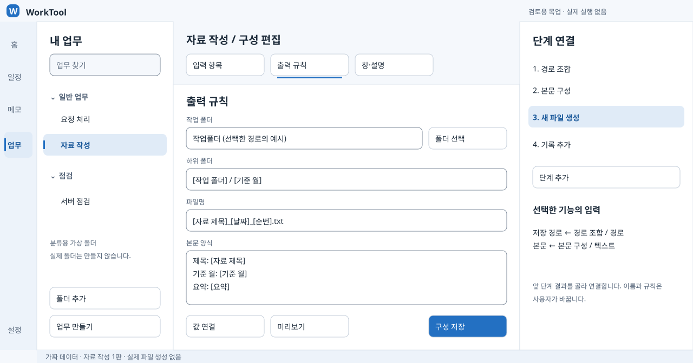
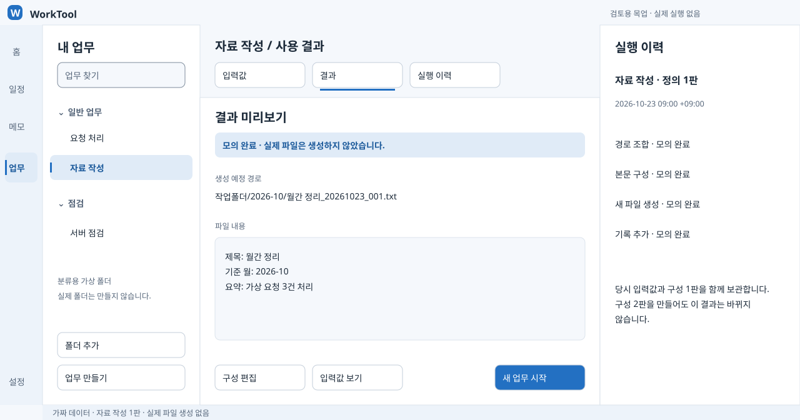
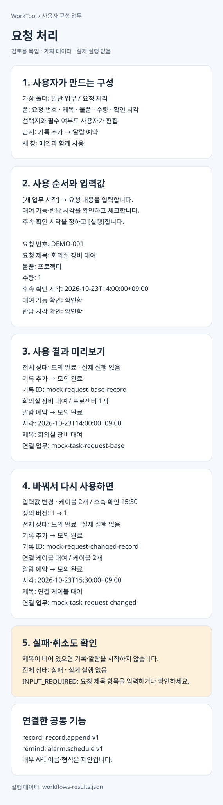
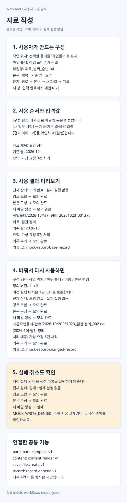
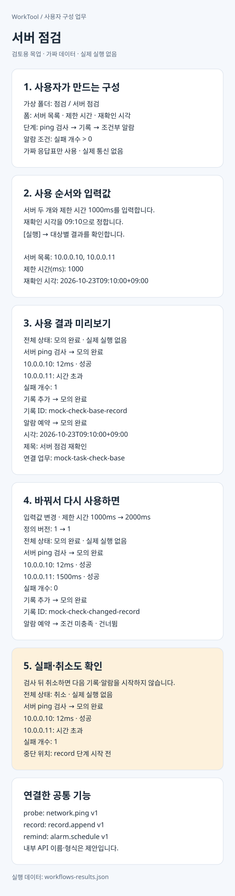

# 업무 탭 — 직접 구성하고 사용한 결과 미리보기

> 구현 방향은 [업무 탭 설계](workflows-design.md)에서 정했습니다. 업무 기능은 `scripts/`의 스크립트로 만들고, 업무 탭은 그 스크립트를 폼으로 실행하는 틀부터 만듭니다. 이 문서는 화면 흐름을 보여 주는 목업입니다.

**긴 설명 대신 직접 눌러 보기:** [업무 체험 HTML](../../apps/WorkTool/design/workflows-playground.html). 경로는 `apps/WorkTool/design/workflows-playground.html`입니다. 파일 하나를 내려받아 브라우저에서 엽니다. GitHub 파일 보기 화면에서는 HTML을 실행하지 않습니다.

`구성하기`에서 폼 항목과 처리 단계를 바꾸고, `사용하기`에서 값을 입력한 뒤 모의 실행하세요. `결과·이력`에서 파일 내용, 조건부 알람, 가상 URL 탭과 이전 구성을 확인합니다. 보조 창의 메인 조작 허용 여부도 체험할 수 있습니다. `동작 구조`에는 실제 WPF 구현에서 검증할 비동기 실행·저장 복구·알람 중복 방지를 짧게 정리했습니다.

HTML은 외부 리소스와 설치가 필요 없는 별도 체험판입니다. 업무 시작 준비 예시를 포함해 공통 기능 9개를 조합합니다. 데이터와 이력은 현재 탭의 메모리에만 있으며 새로고침하면 초기화됩니다. 실제 WPF 백엔드·성능·파일 저장을 구현하거나 보장하는 자료는 아닙니다.

이미지로 먼저 보려면 [입력·미리보기](../../apps/WorkTool/design/workflows-playground-use.jpg)와 [사용 결과 일부](../../apps/WorkTool/design/workflows-playground-result.jpg)를 여세요. 경로는 `apps/WorkTool/design/workflows-playground-use.jpg` · `workflows-playground-result.jpg`입니다.

**디자인 검토용 목업입니다. 현재 WorkTool에 이 업무 탭이나 아래 API가 구현되어 있지는 않습니다.** 모든 입력과 결과는 가짜입니다. 파일·폴더 생성, 서버 통신, 프로그램·스크립트 실행, 일정 변경, 알람 예약은 하지 않습니다.

사용자는 직무에 맞는 업무를 직접 만듭니다. 작업 폴더, 파일명, 입력 항목, 선택지, 절차, 출력 양식과 연결할 기능을 바꿀 수 있어야 합니다. 아래 세 가지는 범용성을 확인하는 예시이며, 고정 업무 목록이 아닙니다.

## 먼저 볼 그림

폰에서는 아래 세로 확대본을 순서대로 보세요. 위에서 아래로 **구성 → 사용 → 모의 결과 → 설정 변경 → 실패·취소**가 이어집니다. 앱을 직접 조작할 수 있는 데모는 아닙니다.

- [요청 처리 PNG](../../apps/WorkTool/design/workflows-request.png)
- [자료 작성 PNG](../../apps/WorkTool/design/workflows-report.png)
- [서버 점검 PNG](../../apps/WorkTool/design/workflows-check.png)

전체 화면 경로: `apps/WorkTool/design/workflows-overview.svg` · [PNG](../../apps/WorkTool/design/workflows-overview.png)


자료 작성의 **구성 편집 → 사용 결과** 화면도 비교해 보세요. 아래 세로 확대본은 이 흐름을 폰에서 읽기 쉽게 풀어 놓은 설명용 그림입니다.

구성 화면 경로: `apps/WorkTool/design/workflows-builder.svg` · [PNG](../../apps/WorkTool/design/workflows-builder.png)



결과 화면 경로: `apps/WorkTool/design/workflows-result.svg` · [PNG](../../apps/WorkTool/design/workflows-result.png)



## 화면을 쓰는 방식

1. 왼쪽 업무 트리에서 [폴더 추가]로 분류하고 [업무 만들기]를 누릅니다. 이 폴더는 앱 안의 분류이며 디스크 폴더를 만들지 않습니다.
2. [구성 편집]에서 입력 항목·선택지·필수 여부·도움말을 정합니다. [단계 추가]에서 공통 기능을 고르고, 각 기능의 입력값을 앞 단계의 결과와 연결합니다.
3. 폼과 결과 미리보기를 확인하고 구성을 저장합니다. 처음 쓰는 사람은 화면에서 편집하고, 익숙한 사람은 같은 내용을 JSON으로 확인할 수 있습니다.
4. 업무를 선택하고 [새 업무 시작]을 누릅니다. 실제 요청마다 별도 업무 건이 생기고, 입력값·체크 상태·기록을 보관합니다.
5. 값을 입력하고 [실행]합니다. 진행과 결과를 같은 화면에서 확인하며, 오래 걸리는 단계는 [취소]를 제공합니다.

오른쪽 [설명] 패널은 열고 닫습니다. 매뉴얼과 선택한 기능의 설명을 표시합니다. 호버 설명은 보조 정보이며 클릭·키보드 포커스로도 같은 내용을 볼 수 있어야 합니다. 중요한 실행 기능을 호버 안에만 넣지 않습니다.

[새 창에서 열기]는 업무 구성의 창 방식에 따라 동작합니다. **함께 사용**은 메인 창을 계속 조작하고, **입력 완료까지 대기**는 해당 창을 닫거나 완료할 때까지 메인 조작을 막는 제안입니다. 여러 창에서 같은 업무 건을 수정할 때는 변경 충돌을 검사해야 합니다. 이 목업은 창·저장 충돌의 실제 동작을 검증한 결과가 아닙니다.

## 예시 1. 요청 처리

### 업무 구성

- 가상 위치: `일반 업무 / 요청 처리`
- 입력: 요청 번호, 요청 제목, 물품(선택), 수량, 후속 확인 시각, 확인용 체크 항목 두 개
- 물품 선택지: 프로젝터·케이블·기타. 이 목록도 사용자가 편집합니다.
- 단계: 입력 검증 → 요청 기록 → 후속 알람 예약
- 창 방식: 함께 사용. 오른쪽 설명에 대여 확인 절차를 표시합니다.

### 사용자 사용법

1. [새 업무 시작]에서 요청 번호 `DEMO-001`, 제목 `회의실 장비 대여`, 물품 `프로젝터`, 수량 `1`을 입력합니다.
2. `대여 가능 확인`, `반납 시각 확인`을 체크합니다.
3. 후속 확인 시각을 `2026-10-23 14:00 +09:00`으로 정하고 [실행]합니다.

### 모의 결과와 변경

- 요청 한 건과 그 요청에 연결된 알람 한 건이 생기는 모습입니다. 화면과 JSON에 모두 `simulation`으로 표시합니다.
- 같은 업무에서 새 업무 건을 시작한 뒤 물품은 `케이블`, 수량은 `2`, 후속 확인은 `15:30`으로 입력하고 실행하면, 새 입력에 맞는 기록과 알람 결과를 얻습니다. 기존 업무 건의 기록·예약을 갱신하는 예시가 아닙니다.
- 요청 제목이 비어 있으면 입력칸 아래에 오류를 표시하고 기록·알람 단계를 시작하지 않습니다.

그림 경로: `apps/WorkTool/design/workflows-request.svg`



## 예시 2. 자료 작성

### 업무 구성

- 가상 위치: `일반 업무 / 자료 작성`
- 입력: 자료 제목, 기준 월, 요약
- 작업 위치: 사용자가 선택한 폴더. 샘플의 `작업폴더`는 예시 표시이며 실제 경로로 접근하지 않습니다.
- 하위 폴더: `${settings.root}/${input.month}`
- 파일명: `${input.title}_${context.date}_${context.sequence}.txt`
- 본문 양식: 제목·기준 월·요약을 배치한 텍스트 양식
- 단계: 경로 조합 → 본문 구성 → 새 파일 생성 → 생성 기록

### 사용자 사용법

1. [구성 편집]에서 작업 루트 폴더를 선택하고 하위 폴더·파일명 규칙·본문 양식을 정합니다. [값 연결]에서 날짜·입력 항목·앞 단계 결과를 고릅니다. 위 표기법은 연결 결과를 JSON으로 확인할 때 보이는 제안 문법입니다.
2. 업무를 시작하고 제목 `월간 정리`, 기준 월 `2026-10`, 요약 `가상 요청 3건 처리`를 입력합니다.
3. [결과 미리보기]에서 경로와 본문을 확인한 뒤 [실행]합니다.

### 모의 결과와 변경

- 생성 예정 경로: `작업폴더/2026-10/월간 정리_20261023_001.txt`
- 본문: `제목: 월간 정리`, `기준 월: 2026-10`, `요약: 가상 요청 3건 처리`의 세 줄입니다.
- 구성 2판에서 루트를 `다른작업폴더`, 하위 폴더를 `완료/기준 월`, 파일명 순서를 날짜·제목·순번으로 바꾸면 `다른작업폴더/완료/2026-10/20261023_월간 정리_002.txt`가 됩니다. 본문 양식도 두 줄로 바뀝니다.
- 저장 실패 사례에서는 파일 생성 단계가 실패하고 다음 생성 기록은 실행하지 않습니다. 실패 이력은 별도로 남기는 제안입니다.
- 실제 구현은 같은 이름의 기존 파일을 덮어쓰지 않습니다. 날짜·순번, 이름 검증, 선택한 작업 폴더 밖 경로 차단을 저장 기능에서 처리해야 합니다. 목업의 순번은 고정 가짜 값이며 디스크의 중복 파일을 조회하지 않습니다.

샘플은 새로 입력한 가짜 텍스트만 사용합니다. DRM 문서를 읽거나 평문으로 변환하는 기능은 이 제안에 포함하지 않습니다. Office 출력 형식은 이후 같은 출력 기능 목록에 추가할 수 있지만, 이 목업으로 Office 파일 생성까지 검증한 것은 아닙니다.

그림 경로: `apps/WorkTool/design/workflows-report.svg`



## 예시 3. 서버 점검

### 업무 구성과 사용법

1. 입력 폼에 서버 목록, 제한 시간, 재확인 시각을 둡니다. 샘플 대상은 가짜 `10.0.0.10`, `10.0.0.11`입니다.
2. 단계는 ping 검사 → 결과 기록 → `실패 개수 > 0`일 때 재확인 알람 순서입니다. 조건도 구성 화면에서 선택합니다.
3. 제한 시간 `1000ms`, 재확인 시각 `2026-10-23 09:10 +09:00`을 입력하고 [실행]합니다.

### 모의 결과와 변경

- 고정 응답표를 사용해 첫 서버는 `12ms`, 둘째는 시간 초과로 표시합니다. 실패 한 건이므로 알람 예약 결과가 생깁니다. 실제 ping은 보내지 않습니다.
- 제한 시간을 `2000ms`로 바꾸면 샘플 응답표의 둘째 서버 `1500ms`가 성공으로 바뀝니다. 실패가 0이므로 알람 단계는 건너뜁니다.
- 검사 뒤, 기록 단계 직전에 취소한 사례도 보여 줍니다. 검사 결과는 남지만 기록·알람 단계는 실행하지 않습니다. 이미 실행한 외부 동작을 취소만으로 되돌릴 수는 없습니다.

그림 경로: `apps/WorkTool/design/workflows-check.svg`



## API처럼 제공한다는 뜻

외부 서버를 설치하지 않는 **프로그램 내부 호출 규약**을 제안합니다. 기능을 등록할 때 이름, 설명, 버전, 입력 형식, 반환 형식, 발생 가능한 오류와 부작용을 함께 선언합니다. 구성 화면은 이 목록으로 [단계 추가]와 입력 편집기를 만듭니다. 화면과 사용자 스크립트가 같은 공통 기능을 호출하도록 설계합니다.

업무 정의는 데이터입니다. `${input.title}`, `${steps.path.path}` 같은 참조는 값을 연결하며 PowerShell 코드를 평가하지 않습니다. 코드 실행은 별도의 명시적인 스크립트 기능입니다. 임의 스크립트의 안전성을 이 데이터 형식이나 목업이 보장하지는 않습니다.

작은 공통 기능을 조합해 새 업무를 만들고, 새로운 종류의 기능은 등록 목록에 추가합니다. 업무별 옵션을 공통 실행부에 조건문으로 넣지 않습니다. 목업 생성기에 있는 소수의 모의 처리기는 예시 검산용이며 실제 확장 엔진은 아닙니다.

### 예시 계약: 알람 예약

아래 이름과 형식은 **제안**입니다. 현재 호출할 수 있는 명령은 아닙니다.

```json
{
  "action": "alarm.schedule",
  "version": 1,
  "args": {
    "at": "${input.followupAt}",
    "title": "${input.title}",
    "message": "요청 ${input.requestNo} 후속 확인",
    "taskId": "${context.instanceId}"
  }
}
```

성공 응답은 `status`, `data`, `error`를 같은 모양으로 돌려줍니다. 알람 ID와 연결 업무 ID를 반환해야 이후 변경·취소·알람에서 업무 열기가 가능합니다. 예약 성공과 실제 알림 표시 완료는 다른 상태입니다. 실제 오류는 `status: failed`, `data: null`, `error: {code, message, field}` 형태로 제안합니다.

```json
{
  "mode": "simulation",
  "status": "succeeded",
  "data": {
    "alarmId": "mock-request-base-remind",
    "state": "scheduled",
    "at": "2026-10-23T14:00:00+09:00",
    "title": "회의실 장비 대여",
    "message": "요청 DEMO-001 후속 확인",
    "taskId": "mock-task-request-base"
  },
  "error": null
}
```

`status: cancelled`는 중단, `skipped`는 조건 미충족을 뜻합니다. 필수 입력 오류는 실행 전에 막고, 단계 실패 때는 기본적으로 이후 단계를 중단합니다. 한 단계의 일부 대상 실패는 반환 데이터로 구분합니다. 예를 들어 ping 응답을 모두 수집했으면 호출은 성공하고, 대상별 성공·시간 초과와 `failedCount`를 따로 반환합니다.

### 기능 목록의 범위

- 이번 모의 계산: `path.compose`, `content.render`, `file.create`, `record.append`, `network.ping`, `alarm.schedule`
- 후속 설계: 알람 변경·취소·다시 알림, 일정 생성·수정, 매뉴얼 표시, 체크리스트, 새 창 열기, 여러 URL 열기, 프로그램·사용자 스크립트 실행
- URL의 브라우저·새 창·탭 방식, 실행 파일·인수·작업 폴더, 출력 형식도 각 기능의 입력으로 노출합니다. 외부 브라우저와 앱 내부 웹 화면의 지원 범위는 아직 확정하지 않았습니다.
- 취소·시간 제한·진행 표시·저장 실패·중복 실행을 공통 규약으로 다뤄야 합니다. 실행 권한과 원본 보호 규칙은 모든 기능에 적용합니다.

## 기존 알람과 연결

현재 WinForms의 [Schedule.psm1](../../apps/WorkTool/modules/Schedule.psm1)은 일정 데이터와 타이머·알림 창이 묶여 있고, 외부로 공개하는 함수는 화면 생성 함수입니다. 기존 소리·확인·다시 알림 동작을 바탕으로, 예약 관리와 알림 표시를 공통 기능으로 옮기는 방향입니다.

WPF의 [Schedule.psm1](../../apps/WorkTool/wpf/addons/schedule/Schedule.psm1)은 일정 조회·표시만 제공합니다. 따라서 **이번 알람은 실제 기존 API 호출 결과가 아니라, 공통화 후의 사용 모습을 보여 주는 시뮬레이션**입니다.

- 일정 탭과 업무 탭이 같은 알람 기능을 공유하도록 설계합니다. 업무마다 별도 타이머를 복제하지 않습니다.
- 알람은 업무 ID와 예약 ID로 연결하고, 완료·삭제·일정 변경 시 예약을 어떻게 처리할지 설정할 수 있어야 합니다.
- 현재 알람은 앱 실행 중에만 동작합니다. 트레이 상태는 포함하며 앱 종료 후 알림은 지원한다고 가정하지 않습니다.
- 다시 시작했을 때 지난 알람 처리, 중복 방지, 반복 회차, 다시 알림 보존은 실제 구현에서 검증할 항목입니다. 이번에는 예약 결과만 계산하고 실제 소리·알림 창은 띄우지 않습니다.

## JSON과 기록을 나누는 방식

1. **업무 정의:** 폼, 선택지, 매뉴얼, 단계, 조건, 경로·출력 규칙, 창 방식, 정의 버전.
2. **개별 업무 건:** 정의 ID, 입력값, 체크 상태, 진행 상태, 생성 시각.
3. **실행 이력:** 사용한 정의 버전과 사본, 실행 당시 입력·설정, 단계별 결과·오류·취소 지점.

구성을 수정해도 이전 이력이 새 양식으로 바뀌지 않아야 합니다. 샘플 결과에는 정의 사본과 입력을 함께 넣었습니다. 실제 저장 파일을 어떻게 분할할지와 마이그레이션은 후속 구현 설계에서 정합니다.

### 사용자 출력의 대량·대용량 생성 통제

**사용자 결과 파일은 건당으로 만들어도 됩니다.** 여러 결과를 한 번에 찾는 목록 파일을 함께 두는 것도 가능합니다. 핵심은 파일을 무조건 합치는 것이 아니라, 사용자가 구성한 업무가 예상 밖의 대량·대용량 결과를 만들지 않도록 통제하는 것입니다. 이전의 내부 파일 증가 방지 설명만으로 이 요구를 충족했다고 보지 않습니다.

- 결과 목록에는 업무·실행 ID, 파일 경로, 실제 크기, 성공·실패·취소·미완료 상태를 모읍니다. 파일 본문을 목록에 중복 보관하지 않습니다. 건별 파일과 목록이 일치해야 합니다.
- 실행 전에 생성 예정 개수, 파일별·전체 예상 용량, 저장 위치와 디스크 여유 공간을 보여 줍니다. 크기를 미리 알 수 없으면 `산정 불가`로 표시하고 0으로 취급하지 않습니다. 예상치와 확정된 제한을 구분합니다.
- 개수·파일별 크기·실행 전체 용량의 상한을 설정으로 관리합니다. 여러 단계·반복·연계 작업·동시 작업·재시도가 같은 한도를 공유해야 하며, 단계별로 한도를 새로 부여해 우회되지 않게 합니다. 구체적인 기본값은 아직 확정하지 않았습니다.
- 1회 실행 한도 외에도 앱이 생성한 결과의 누적 개수·용량과 남은 디스크 공간을 확인합니다. 반복 실행으로 저장소를 채우는 경우도 대상입니다. 한도에 도달했다고 기존 사용자 파일을 임의 삭제하지 않습니다.
- 공통 출력 API는 생성 전 개수·용량을 예약하고, 생성 중 실제로 쓰는 양을 확인해 상한을 넘는 새 생성·쓰기를 중단해야 합니다. 임시·중간 산출물도 사용량에 포함합니다. 사전 확인만 한 뒤 무제한으로 쓰는 방식은 피합니다.
- 큰 결과를 메모리에 전부 만들지 않고 작은 단위로 생성·저장합니다. 동시 실행 수와 진행 갱신 빈도를 관리하고, 취소 후 추가 출력이 이어지지 않게 합니다.
- 재시도·이어하기와 의도적인 새 출력을 구분합니다. 재시도 때문에 같은 결과가 계속 복제되지 않게 하며, 중단된 출력은 완료로 표시하지 않습니다. 목록과 실제 파일의 불일치도 복구 대상입니다.
- 사용자 스크립트나 외부 프로그램이 공통 출력 API를 거치지 않고 직접 파일을 쓰면 같은 한도를 강제한다고 보장할 수 없습니다. 이를 산정·통제 가능으로 오표시하지 않고, 실제 통제 가능한 범위를 별도로 검증해야 합니다.

내부 로그·백업·임시 파일 관리도 필요하지만 사용자 출력 통제를 대신하지 않습니다. 마지막 정상본과 과거 이력이 참조하는 정의 버전을 보존하고, 사용자 출력 파일을 내부 자동 정리 대상으로 삼지 않습니다. 현재 샘플의 실행별 정의 사본은 설명용이며 실제 저장 방식으로 확정한 것이 아닙니다.

### 로컬 PC에서 검증할 항목

전용 워크트리와 격리된 가짜 데이터 경로를 사용합니다. 실제 업무 데이터·설정에는 접근하지 않습니다.

- 출력 개수·파일별 크기·전체 용량의 경계값 바로 전·정확한 상한·초과를 시험합니다. 검사 자체가 로컬 디스크를 채우지 않도록 별도 테스트 한도를 둡니다.
- 예상보다 실제 결과가 커지는 경우, 크기를 미리 알 수 없는 출력, 반복·동시·연계 실행과 재시도에서도 공유 한도가 유지되는지 확인합니다.
- 실제 대량 파일과 대용량 파일을 제한된 테스트 규모로 생성하며 생성량, 디스크 사용량, 메모리, UI 응답 시간과 취소 지연을 측정합니다. 내부 로그·백업·임시 파일의 누적도 함께 확인합니다.
- 저장 도중 강제 종료, 파일 잠금·권한 오류, 용량 부족, 데이터 손상을 가짜 저장소에서 재현합니다. 완료·미완료 파일과 결과 목록을 맞추고, 정상 결과를 덮어쓰거나 지우지 않는지 확인합니다.
- 중복 실행·동시 저장·재시도 후 결과 복제·기록 유실·늦은 결과 반영이 없는지, 재시작 후에도 누적 사용량과 한도 판단이 맞는지 확인합니다.
- 공통 출력 API를 우회하는 스크립트·외부 프로그램은 별도 시험 대상으로 두고, 검증하지 않은 통제 범위를 지원한다고 표시하지 않습니다.

**위 항목은 아직 수행하지 않은 후속 백엔드 검증 계획입니다.** 현재 HTML은 메모리에서만 동작합니다. 기존 20개 검사는 모의 로직 검사이고, 500개 대상 취소는 가짜 서버 목록 처리입니다. 실제 파일 500개 저장, 대용량 디스크 쓰기, 출력 개수·바이트 한도, 저장·복구 테스트를 통과했다는 뜻이 아닙니다. 문자열 길이 제한도 디스크 출력량 제한을 대신하지 않습니다.

## 파일과 재현

- `apps/WorkTool/design/workflows-sample.json`: 가짜 업무 정의, API 목록, 입력값, 응답표와 기대 상태. `isMock: true`입니다.
- `apps/WorkTool/design/workflows-results.json`: 위 샘플에서 계산한 단계별 결과와 정의 사본. 모든 실행은 `simulation`입니다.
- `apps/WorkTool/design/build-workflows-mockups.ps1`: 샘플 검산과 SVG·PNG 생성. PowerShell 7.6 이상과 Windows 기본 WPF만 사용합니다. 업무 PC에서 실행할 앱 파일이 아닙니다.
- `apps/WorkTool/design/workflows-overview.*`, `workflows-builder.*`, `workflows-result.*`: 전체 입력·구성 편집·결과 화면 세 쌍. `workflows-request.*`, `workflows-report.*`, `workflows-check.*`는 폰용 설명 확대본 세 쌍입니다. 각 쌍은 SVG와 PNG입니다. 색·크기 기준은 [디자인 README](../../apps/WorkTool/design/README.md#사용자-구성-업무-목업--미구현)에 있습니다.

분리된 작업 폴더에서 다시 만들기:

```powershell
pwsh -NoProfile -STA -File apps/WorkTool/design/build-workflows-mockups.ps1
```

생성기는 자기 폴더의 위 목업 산출물만 다시 만듭니다. 앱 모듈을 불러오거나 `문서\WorkTool`, 실제 설정·프로필·서버에 접근하지 않습니다. 샘플 경로를 실제 폴더로 만들지 않습니다. 결과 PNG는 렌더링이며 화면 캡처가 아닙니다.

## 이번 확인의 범위

- 세 가지 업무가 같은 구성 → 입력 → 단계 결과 흐름으로 설명되는지 확인합니다.
- 폴더·파일명·본문·입력·알람 시각·검사 제한 시간을 바꾼 결과를 샘플에서 계산합니다.
- 필수 입력 오류, 저장 실패, 단계 사이 취소, 조건 미충족을 확인합니다.
- JSON 파싱, 참조 연결, 기대 상태·주요 반환값, 그림 경계·한글 줄바꿈, 상대 링크를 검사합니다.

실제 파일 저장·네트워크·알람·프로그램 실행, 모달·키보드·호버 조작, 모든 DPI·테마는 이번 검증 대상이 아닙니다. 앱 소스·배포 묶음은 바꾸지 않습니다. 후속 구현은 전용 워크트리와 가짜 데이터 경로를 함께 분리해야 합니다. 워크트리만 바꾸면 기본 데이터 폴더를 공유할 수 있습니다.

작성 시 검수: 생성기 실행과 9개 사례의 기대값 검사를 통과했습니다. 재생성 전후 결과 JSON·SVG·PNG 13개 파일의 SHA-256이 같았습니다. SVG 6개는 외부 리소스 없이 파싱됐고, 문서의 상대 파일 링크를 확인했습니다. 그림 6개와 문서·샘플의 일치를 검토했으며, 별도 독자 검토에서 입력 변경과 정의 변경의 구분을 보완했습니다.
